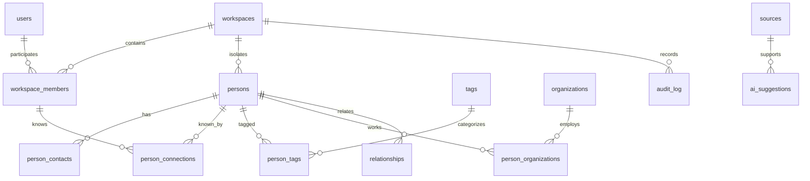

# Модель данных

Все внутренние сущности имеют UUID; изменяемые карточки — version, updated_at, updated_by. `created_at` задаётся сервером. JSONB используется для альтернативных имён, неизменяемого содержимого предложений и минимальных метаданных аудита, а не вместо основных связей.

| Таблица | Назначение / целостность |
|---|---|
| users | Уникальный нормализованный email, имя, Argon2id hash, active |
| workspaces | personal/family, владелец; один Personal на пользователя |
| workspace_members | Составной PK workspace/user; admin/editor/viewer; DB-триггер запрещает чужое членство в Personal |
| sessions | SHA-256 случайного токена и CSRF, пользователь, expiry |
| login_attempts | Хеш IP/идентификатора, счётчик 15-минутного окна |
| invitations | Хеш одноразового токена, адресат, role, expiry, accepted_at |
| persons | Имя обязательно; остальные поля необязательны; search_text + generated tsvector |
| person_contacts | platform + kind + исходное/нормализованное значение, подпись, primary, источник и verification; уникальность внутри карточки |
| person_connections | Участник, человек, knows, индивидуальный priority, основной знакомый (не более одного) |
| tags / person_tags | Имена уникальны в пространстве; M:N |
| organizations / person_organizations | Организация уникальна в пространстве; должность на связи |
| relationships | Два разных человека, тип, directed, комментарий, источник, автор; уникальность ребра |
| sources | Название и reference происхождения предложения |
| ai_suggestions | Операция, target, version, before/payload, confidence, состояние, job/record ключ, автор и reviewer |
| agent_tokens | Хеш токена, пользователь/workspace, expiry, revoked |
| audit_log | Actor/action/entity/time, минимальные metadata; runtime не может UPDATE/DELETE |

Составные FK workspace/person и workspace/member запрещают пересечение пространств. RLS включён FORCE для всех контактных таблиц, источников, предложений и аудита. Таблицы аутентификации, членства, приглашений и токенов читаются для установления авторизации и защищены сервисным слоем. Пользователи не получают прямых DB credentials.

Одинаковое имя не означает дубль. Совпадение надёжного идентификатора вызывает предупреждение; явный override допускает отдельного человека. Telegram username, numeric_id и url — разные kinds. Телефоны сохраняют исходное значение; локальная нормализация 11-значного номера 8… → 7… документирована для целевой российской аудитории. Международные неоднозначные номера автоматически не достраиваются.

События, взаимодействия, автоматические напоминания и pgvector — в Roadmap.
